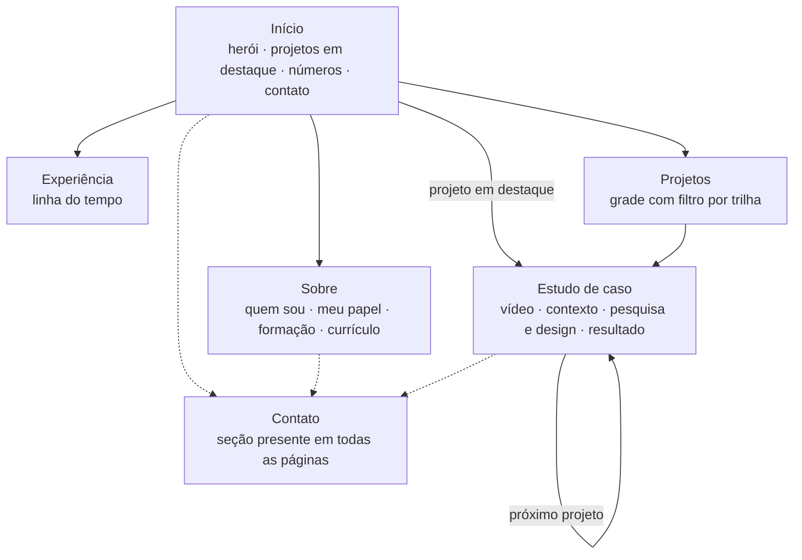

# 00 · Visão e ideação

## 1. O problema

Tiago procura vagas em quatro trilhas: **Software Engineer, DevOps/Cloud Architect, Data Engineer e AI Engineer**. O material público atual não ajuda:

- O README do perfil no GitHub é uma parede de badges com widgets de terceiros que saem do ar, links quebrados e cargo desatualizado.
- O portfólio antigo (`tiagoalcan.vercel.app`) está parado desde julho de 2025 e não mostra o trabalho feito na THCS.
- Os currículos descrevem tarefas, e não a forma de pensar que liga uma entrega à outra.

## 2. O conceito: tornar sistemas visíveis

Olhando as entregas reais, o padrão é sempre o mesmo. Tiago pega algo que ninguém consegue enxergar direito e deixa legível para quem precisa decidir:

| Entrega | O que estava invisível | O que passou a ser visível |
|---|---|---|
| Dashboards de observabilidade | O comportamento de um autorizador de pagamentos com mais de 1 milhão de transações por dia | Painéis simples que o cliente entende sem ler PromQL |
| Documentação técnica | Procedimentos que só existiam na cabeça de quem instalava | Manuais padronizados que qualquer pessoa executa sozinha |
| Testes em BDD | Critérios de qualidade implícitos | Documento adotado pelo cliente como parâmetro de qualidade |
| Skill de IA para documentação | O padrão de escrita da empresa | Um padrão codificado, que a IA aplica sempre igual |
| Risco de crédito com grafos | A dependência entre empresas de uma cadeia de suprimentos | Um peso mensurável no modelo de risco |

A frase que resume o portfólio é **"Eu torno sistemas visíveis"** (em inglês, *"I make systems visible"*).

Ela serve para as quatro trilhas sem forçar: software legível, infraestrutura observável, dados que viram decisão e IA cujo comportamento se consegue acompanhar.

### O método, que vira a estrutura do site

O jeito de trabalhar descrito pelo próprio Tiago é: **prototipar rápido, colocar na mão de quem usa e ajustar pelo feedback**. Cada estudo de caso do portfólio segue esse caminho, em três atos:

1. **Contexto**: qual era o problema e para quem.
2. **Pesquisa e design**: o que foi prototipado, o que foi descartado e por quê.
3. **Resultado**: o que mudou, com números, e o que ficou de aprendizado.

## 3. Para quem é o site

| Visitante | Tempo que dedica | O que precisa encontrar |
|---|---|---|
| Recrutador(a) não técnico(a) | 30 segundos | Cargo, tempo de experiência, trilhas de interesse, currículo para baixar, contato |
| Tech lead ou gestor(a) de engenharia | 2 a 5 minutos | Um estudo de caso com decisões técnicas e números reais |
| Par técnico (dev, SRE, engenheiro de dados) | Tempo livre | Código público, diagramas, os documentos de design deste repositório |

Regra derivada: **a primeira dobra da página inicial responde às perguntas do visitante de 30 segundos**. Nada de animação de abertura que atrase o conteúdo.

### Mensagem por trilha

Os quatro botões de trilha na página inicial filtram os projetos e trocam a frase de apoio.

| Trilha | Frase de apoio | Provas principais |
|---|---|---|
| Software | Construo e opero software que roda em produção, do endpoint à tela. | Java/Spring Boot, TypeScript, Vue, React; integrações REST com autenticação; MoziCash |
| DevOps e Cloud | Coloco sistemas no ar e deixo claro o que acontece com eles lá. | Prometheus, Grafana, Alertmanager; Docker; AWS; Terraform; CI/CD; pós em DevOps e Arquitetura Cloud |
| Data | Transformo eventos em painéis e modelos que alguém consegue usar. | SQL, Kafka, PromQL; Python, Pandas; bootcamp de Ciência de Dados; risco de crédito com grafos |
| AI | Uso IA para tirar trabalho repetitivo do caminho, com um humano no controle. | Skill de IA para documentação; agente financeiro do MoziCash; pipeline de CI/CD com agentes |

## 4. Mapa do site

Todas as páginas existem em **PT-BR** e **EN**, e em tema **claro** e **escuro**.

### O que cada página entrega

**Início.** Retrato, nome, cargo e a frase do conceito. Quatro botões de trilha. Projetos em destaque logo abaixo, já visíveis sem clique. Faixa de números (tempo em produção, transações por dia, trilhas). Resumo do Sobre com link. Contato.

**Sobre.** Quem é, como trabalha e, com mais detalhe, **qual é o papel dele hoje**: desenvolvimento, observabilidade, suporte a produção e condução de mudanças (GMUDs) junto ao cliente. Formação acadêmica com as disciplinas agrupadas por trilha. Cursos e idiomas. Botão para **baixar o currículo** em PT e EN.

**Experiência.** Linha do tempo com os dois períodos na THCS, as entregas de cada um e a stack usada.

**Projetos.** Grade de cartões com filtro por trilha.

**Estudo de caso.** Abre com **vídeo e uma descrição breve**. Ao rolar: contexto, pesquisa e design, resultado. Termina com stack, links e o próximo projeto.

**Contato.** E-mail (`tiago.gomesalcan@gmail.com`) com botão de copiar, LinkedIn, GitHub e um formulário curto.

## 5. Como as referências foram traduzidas

O Tiago trouxe quatro referências. Nenhuma é copiada; cada uma contribui com uma ideia.

### Banner do LinkedIn

*Constelação de pontos ligados, a frase "Technology, Data, Cloud and AI" e uma malha ondulada, em azul sobre fundo escuro.*

Vira o **herói 3D**: um grafo de serviços em que partículas correm pelas arestas, como transações atravessando um sistema. Os nós se agrupam em quatro regiões, uma por trilha. Ao passar o cursor em um botão de trilha, a região correspondente acende. As cores vêm da paleta do site (laranja e creme sobre verde profundo), não do azul original.

### Foto de perfil

*Retrato frontal, camisa azul-marinho, fundo azul-ardósia.*

Entra em **recorte circular**. Como o azul do fundo não pertence à paleta, a foto recebe um anel na cor de destaque e, se o recorte de fundo ficar bom, o fundo é substituído pelo verde da paleta. A decisão final depende de teste com a foto em alta resolução.

### Portfólio de Dalya Baron

*Foto circular grande, nome, um parágrafo curto e quatro botões redondos coloridos de navegação.*

Contribui com a **composição da primeira dobra**: retrato circular de um lado, nome e parágrafo do outro, e quatro botões circulares logo abaixo. No portfólio do Tiago os quatro botões são as trilhas, e funcionam como filtro em vez de levar a outra página.

### Currículo de Gary Le Masson

*Um currículo montado como uma página de resultados do Google.*

Contribui com a ideia de **usar uma interface que o público já conhece**. Para o Tiago, essa interface é o terminal e o painel de observabilidade. A tradução é contida, para o site continuar legível a quem não é técnico:

- Uma **paleta de comandos** (`Ctrl+K` ou `⌘K`) permite navegar, trocar tema e idioma e copiar o e-mail, como num shell.
- Os estudos de caso mostram resultados em **painéis de métricas** com a estética de um dashboard.
- Rótulos pequenos em fonte monoespaçada marcam seções (`01 / contexto`).

O que **não** se faz: transformar o site inteiro em um terminal falso. Texto corrido continua em fonte de leitura, e a navegação principal é um menu comum.

## 6. Ligação com o README do GitHub

O README do perfil usa o mesmo conceito em formato de terminal: comandos que se expandem (`$ cat experiencia.log`, `$ ls projetos/`, `$ man curiosidade`). O README é a porta de entrada rápida; o portfólio é onde o visitante vê os estudos de caso completos. Os dois compartilham paleta, tom de voz e a frase do conceito.

## 7. Princípios de conteúdo

1. **Número antes de adjetivo.** "Mais de 1 milhão de transações por dia" comunica mais que "alto volume".
2. **Clientes anonimizados.** O site fala em "grandes instituições financeiras brasileiras". Nenhum nome de cliente, print de ambiente real ou detalhe de arquitetura interna.
3. **Papel explícito.** Em cada projeto fica claro o que o Tiago fez e o que foi do time.
4. **Honestidade sobre o estágio.** Projeto em andamento aparece marcado como "em andamento".
5. **Dados pessoais mínimos.** Só e-mail, LinkedIn e GitHub. Telefone e documentos não aparecem em nenhum lugar, nem no currículo para download.

## 8. O que fica fora do escopo

- Blog. Pode vir depois; o modelo de conteúdo em MDX já comporta.
- Área logada, comentários ou qualquer dado de visitante além do formulário de contato.
- Chatbot de IA sobre o currículo. É tentador para a trilha de AI, mas adiciona custo e risco sem ajudar o visitante de 30 segundos. Fica registrado como ideia futura.
