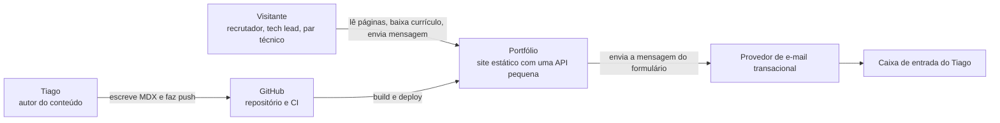
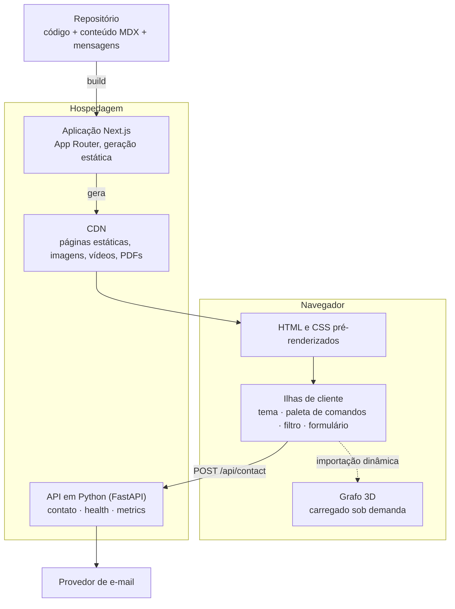
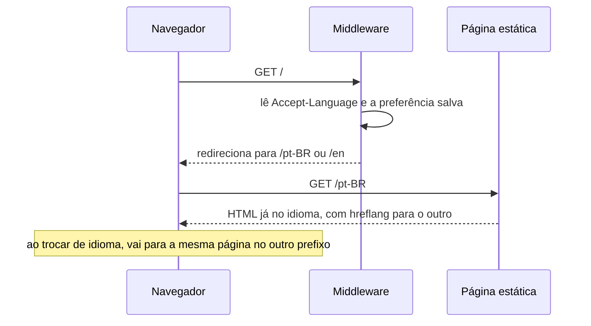
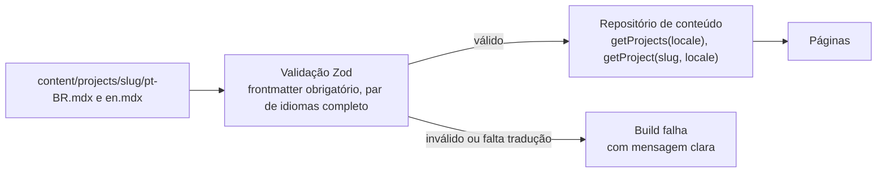
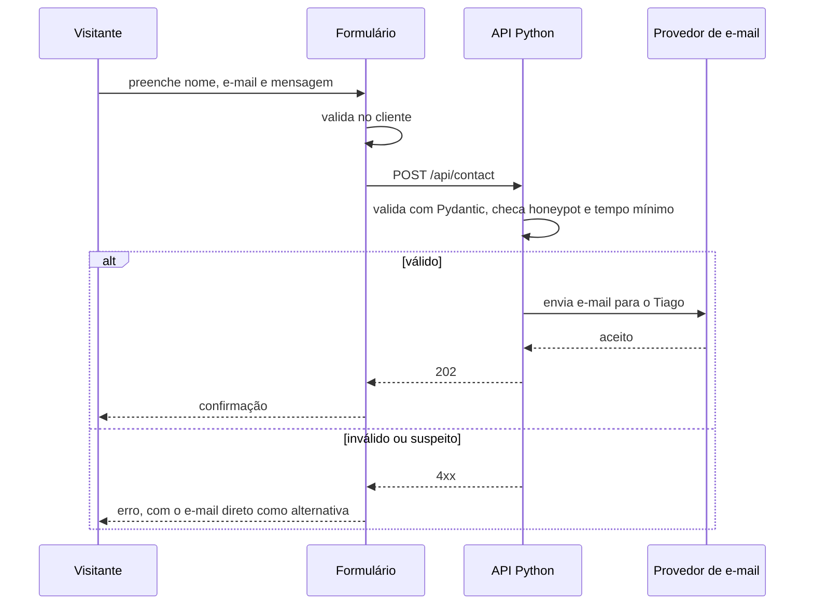
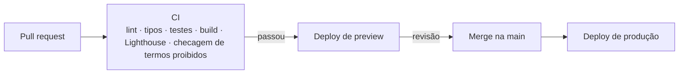

# 02 · System design

## 1. Requisitos

### Funcionais

| # | Requisito |
|---|---|
| RF1 | Páginas: Início, Sobre, Experiência, Projetos, Estudo de caso |
| RF2 | Todo o conteúdo em PT-BR e EN, com troca de idioma que mantém a página atual |
| RF3 | Tema claro, escuro e automático (segue o sistema), com a escolha lembrada |
| RF4 | Projetos em destaque na página inicial, filtráveis por trilha |
| RF5 | Estudo de caso com vídeo, descrição breve, contexto, pesquisa e design, resultado |
| RF6 | Download do currículo em PDF, em PT e EN |
| RF7 | Contato por e-mail (link e copiar) e por formulário |
| RF8 | Paleta de comandos para navegação por teclado |

### Não funcionais

| # | Requisito | Meta |
|---|---|---|
| RNF1 | Performance | LCP abaixo de 2,5 s e CLS abaixo de 0,1 em celular intermediário com 4G |
| RNF2 | Qualidade medida | Lighthouse 95 ou mais em performance, acessibilidade, boas práticas e SEO |
| RNF3 | Acessibilidade | WCAG 2.2 AA |
| RNF4 | Resiliência | Site legível sem JavaScript e sem WebGL |
| RNF5 | Privacidade | Sem cookies de rastreio; nenhum dado de cliente ou documento pessoal no repositório |
| RNF6 | Custo | Plano gratuito de hospedagem |
| RNF7 | Manutenção | Adicionar um projeto é criar dois arquivos MDX, sem tocar em componentes |

## 2. Contexto (C4 nível 1)



## 3. Containers (C4 nível 2)



**Ponto central do desenho:** quase tudo é gerado no build. Não há banco de dados nem renderização por requisição. A única parte dinâmica é a API de contato.

## 4. Stack

| Camada | Escolha | ADR |
|---|---|---|
| Framework | Next.js (App Router) com React e TypeScript estrito | [0001](adr/0001-nextjs-em-vez-de-astro.md) |
| Estilo | Tailwind CSS 4, tokens em CSS variables | |
| Idiomas | `next-intl` | [0002](adr/0002-next-intl-para-idiomas.md) |
| Tema | `next-themes` | |
| Conteúdo | MDX no repositório, validado com Zod | [0006](adr/0006-conteudo-em-mdx-no-repositorio.md) |
| 3D | React Three Fiber e drei | [0003](adr/0003-react-three-fiber-para-3d.md) |
| Animação | Motion e View Transitions | |
| Backend | FastAPI (Python) | [0004](adr/0004-fastapi-para-contato-e-metricas.md) |
| Testes | Vitest, Playwright, axe | |
| Hospedagem | Vercel | |

As versões exatas são fixadas no início da implementação, depois de conferir a documentação atual de cada biblioteca.

## 5. Rotas

| Rota PT-BR | Rota EN | Renderização |
|---|---|---|
| `/pt-BR` | `/en` | Estática |
| `/pt-BR/sobre` | `/en/about` | Estática |
| `/pt-BR/experiencia` | `/en/experience` | Estática |
| `/pt-BR/projetos` | `/en/projects` | Estática |
| `/pt-BR/projetos/[slug]` | `/en/projects/[slug]` | Estática, uma por projeto |
| `/api/contact` | | Função Python |
| `/api/health`, `/api/metrics` | | Função Python |

A raiz `/` redireciona para o idioma do navegador (`Accept-Language`), com PT-BR como padrão. Os `slug` de projeto são iguais nos dois idiomas, para simplificar a troca.

## 6. Estrutura do repositório

```
portfolio/
├── docs/                     documentos de design e ADRs
├── content/
│   ├── projects/<slug>/      pt-BR.mdx, en.mdx, capa, mídia
│   ├── experience.ts         linha do tempo, com textos nos dois idiomas
│   └── education.ts          formação e cursos
├── messages/                 pt-BR.json, en.json (textos de interface)
├── src/
│   ├── app/[locale]/         páginas e layouts
│   ├── components/
│   │   ├── ui/               primitivos
│   │   ├── sections/         blocos de página
│   │   ├── case-study/       componentes do estudo de caso
│   │   ├── command-palette/
│   │   └── three/            grafo 3D e versão estática
│   ├── lib/
│   │   ├── content/          schemas Zod e repositório de conteúdo
│   │   ├── i18n/             configuração e navegação localizada
│   │   └── seo/              metadados, JSON-LD, sitemap
│   └── styles/tokens.css
├── api/                      FastAPI
├── public/                   vídeos, currículos, imagens Open Graph
└── tests/                    unit/ e e2e/
```

## 7. Fluxos

### Idioma



### Tema

1. Um script mínimo no `<head>` lê a preferência salva, ou a do sistema, e define o atributo de tema **antes da primeira pintura**. Isso evita o flash do tema errado.
2. Os tokens em `tokens.css` mudam conforme o atributo.
3. O botão de tema alterna entre claro, escuro e sistema e grava a escolha.
4. O grafo 3D lê os tokens e se redesenha quando o tema muda.

### Conteúdo



### Contato



O link `mailto:` e o botão de copiar ficam sempre visíveis. Se a API cair, o contato continua funcionando.

## 8. API em Python

| Endpoint | Método | Função |
|---|---|---|
| `/api/contact` | POST | Recebe `name`, `email`, `message`, `locale`; envia o e-mail |
| `/api/health` | GET | Responde `200` com a versão do build |
| `/api/metrics` | GET | Expõe métricas em formato Prometheus |

### Proteção do formulário

- Validação de tipos e tamanhos com Pydantic.
- Campo honeypot invisível e tempo mínimo de preenchimento.
- Limite de taxa aplicado na borda da hospedagem, porque a função não guarda estado entre chamadas.
- A chave do provedor de e-mail fica em variável de ambiente e nunca vai para o cliente.
- O conteúdo da mensagem é tratado como texto puro.

### Limite conhecido das métricas

Funções serverless não mantêm contadores em memória entre invocações. Por isso `/api/metrics` começa expondo apenas `build_info` e o resultado do `health`. Contadores reais (mensagens enviadas, erros) só entram se houver um armazenamento externo, o que fica como evolução e está registrado no ADR 0004.

## 9. Performance

### Orçamento

| Item | Limite |
|---|---|
| JavaScript inicial da página (comprimido) | 130 kB |
| Chunk do grafo 3D, carregado depois (comprimido) | 250 kB |
| Imagem do herói | 60 kB em AVIF |
| Fontes | 3 famílias, só os pesos usados, subconjunto latino |
| Vídeo | Nunca carregado antes do clique (`preload="none"` e poster) |

### Estratégias

- Geração estática de todas as páginas.
- Server Components por padrão; JavaScript de cliente só nas ilhas.
- O elemento de LCP é texto ou o retrato, nunca o canvas.
- O grafo 3D é importado depois que a página fica ociosa e só em telas que suportam.
- `next/image` com dimensões explícitas, para não mover o layout.
- Vídeos em WebM e MP4, com até 60 segundos e 1080p.

## 10. SEO e compartilhamento

- `title` e `description` por página e por idioma.
- `hreflang` ligando as duas versões e `x-default` apontando para PT-BR.
- Imagem Open Graph por página, gerada no build com a paleta.
- `sitemap.xml` e `robots.txt`.
- JSON-LD `Person` na página inicial e `CreativeWork` nos estudos de caso.

## 11. Segurança e privacidade

- Cabeçalhos: Content-Security-Policy, `X-Content-Type-Options`, `Referrer-Policy` e `Permissions-Policy`.
- Sem cookies de rastreio. Se houver analytics, será sem cookies e agregado.
- Nenhum segredo no repositório; `.env.example` documenta as variáveis.
- **Verificação automática no CI**: o build falha se o conteúdo gerado contiver nomes de clientes, telefone ou números de documento. A lista de termos proibidos fica em um arquivo de configuração.

## 12. Observabilidade do próprio site

Um portfólio cujo conceito é "tornar sistemas visíveis" precisa ser observável:

- `/api/health` e `/api/metrics`, descritos acima.
- Core Web Vitals reais coletados pela hospedagem.
- Um indicador discreto de status no rodapé, que consulta o `health`.
- Lighthouse rodando no CI a cada pull request, com as metas do RNF2 como limite.

## 13. Entrega



## 14. Riscos

| Risco | Mitigação |
|---|---|
| O 3D prejudica performance em celular | Três níveis de qualidade e versão estática; orçamento medido no CI |
| Tradução desatualizada em um idioma | O build falha se faltar o par de arquivos ou uma chave de mensagem |
| Vazamento de informação de cliente | Conteúdo anonimizado desde a origem e checagem automática no CI |
| Hospedar Python ao lado do Next muda de forma entre versões da plataforma | Conferir a documentação atual antes de implementar; a API é pequena e pode ser movida |
| Vídeos pesados | Limite de duração e resolução, carregamento sob demanda |
